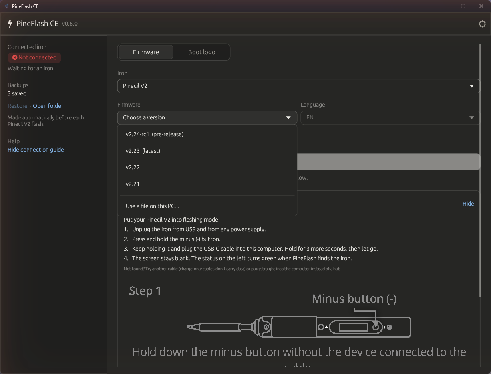
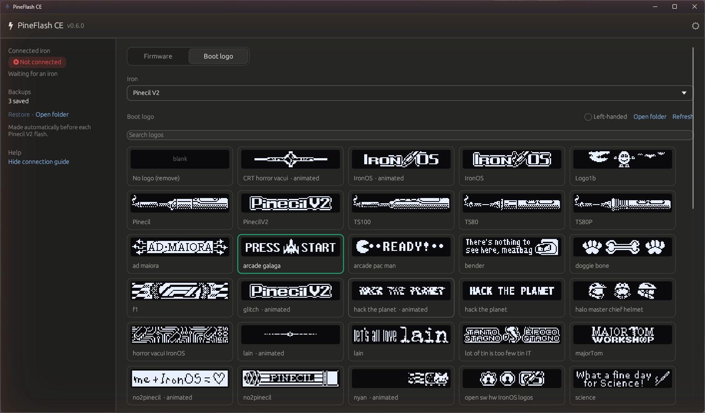
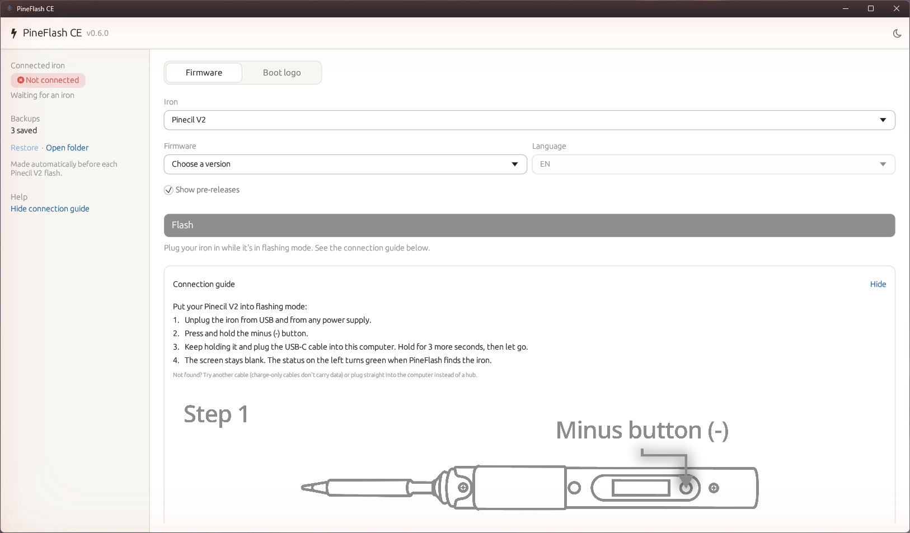

[](https://github.com/GRIMREAPER35487/pineflash-CE/releases/latest)
[](https://github.com/GRIMREAPER35487/pineflash-CE/releases)
[](https://github.com/GRIMREAPER35487/pineflash-CE/actions/workflows/windows-installer.yml)

# PineFlash CE

**Flash IronOS firmware and boot logos onto your Pinecil, with a backup taken first and every byte checked.**

PineFlash CE (Community Edition) is a continuation of [PineFlash](https://github.com/Spagett1/PineFlash) by Spagett1. All credit for the original app goes to Spagett1 and its contributors. CE carries it on with fixes and new features, most of all a Pinecil V2 flasher that works on Windows.

> Looking for the original app? See **[classic PineFlash](https://github.com/Spagett1/PineFlash)**, or its README kept here as [docs/CLASSIC_README.md](docs/CLASSIC_README.md).



## Download

**Windows:** get `pineflash-ce-<version>-win64-setup.exe` from the **[latest release](https://github.com/GRIMREAPER35487/pineflash-CE/releases/latest)** and run it. It installs alongside the original PineFlash rather than replacing it.

Each installer is built by GitHub Actions from the tagged source ([workflow](.github/workflows/windows-installer.yml)), and a `.sha256` checksum is published next to it.

**Linux and macOS:** build from source (see [Building](#building)). The install and dependency notes in the [classic README](docs/CLASSIC_README.md) still apply.

## What's new in CE

### A Pinecil V2 flasher that works on Windows
Classic PineFlash uses `blisp` for the Pinecil V2, and on many Windows PCs it never gets past *"Failed to handshake with device"*. CE has its own flasher built in, which talks to the iron's bootloader directly, so Windows no longer needs `blisp`.

### Safety first
- **Automatic backup** of the iron's whole flash before every Pinecil V2 write, saved to `~/PineFlash/backups`, with a **Restore** button to put one back.
- **Verified writes:** every byte written is read back and compared.
- The boot header and **your IronOS settings are left untouched** and checked afterwards.
- If the iron stops answering, the app tells you how to reconnect it instead of hanging.

### Boot logos on the Pinecil V2
Switch to **Boot logo** mode for a gallery of every logo from [IronOS-Meta](https://github.com/Ralim/IronOS-Meta), drawn exactly as the iron's screen will show it, animated ones included. Pick one and flash it: only the logo area is written, after a backup. There's also a left-handed (upside-down) option and a "No logo" choice to remove it again.



### And also
- Stable IronOS releases by default, with a **Show pre-releases** switch for release candidates.
- A connection status sidebar, a built-in guide to flashing mode, a progress bar and clear notifications.
- Light and dark themes.
- Clear error messages instead of crashes for network problems, GitHub rate limits and failed flashes.
- The window stays responsive while the app looks for the iron.



## Supported irons

| | Windows | Linux | macOS |
| :-- | :-- | :-- | :-- |
| **Pinecil V2** firmware | Built-in flasher | `blisp` | `blisp` |
| **Pinecil V2** boot logos | Built-in flasher | `blisp` 0.0.4 or newer | `blisp` 0.0.4 or newer |
| **Pinecil V1** firmware and logos | `dfu-util` (bundled) | `dfu-util` | `dfu-util` |

The built-in Windows flasher has been tested on a Pinecil V2. The V1, Linux and macOS paths are carried over from classic PineFlash.

## Putting the iron in flashing mode

1. Unplug the iron from USB and from any power supply.
2. Hold the **minus (-)** button.
3. Keep holding it, plug the USB-C cable into your computer, and keep holding for about 3 more seconds.
4. The iron's screen stays blank. The sidebar in PineFlash CE turns green when it finds the iron.

If it isn't found, try another cable (charge-only cables don't carry data) and plug straight into the computer instead of a hub. Never use the barrel jack while flashing.

## Building

```
cargo build --release
```

To build the Windows installer as well:

```
powershell -ExecutionPolicy Bypass -File scripts\fetch-windows-tools.ps1
ISCC Package_Windows_Release.iss
```

`fetch-windows-tools.ps1` downloads `dfu-util` for the Pinecil V1 and checks it against a pinned checksum. `ISCC` is the [Inno Setup 6](https://jrsoftware.org/isinfo.php) compiler.

**Publishing a release:** bump `version` in `Cargo.toml`, commit, then push a matching tag (for example `v0.6.1`). GitHub Actions builds the installer and publishes the release; tags with a `-`, such as `v0.7.0-beta.1`, become pre-releases.

For Linux and macOS build dependencies, see the "Build from code" section of the [classic README](docs/CLASSIC_README.md).

## Credits

- [PineFlash](https://github.com/Spagett1/PineFlash) by Spagett1 and contributors: the original app.
- [blisp](https://github.com/pine64/blisp) (MIT): the Pinecil V2 protocol the built-in flasher follows, and Bouffalo Lab's flash loader (Apache-2.0, see [assets/bl70x_eflash_loader.NOTICE.txt](assets/bl70x_eflash_loader.NOTICE.txt)).
- [IronOS](https://github.com/Ralim/IronOS) and [IronOS-Meta](https://github.com/Ralim/IronOS-Meta) by Ralim and contributors: the firmware and boot logos.
- [dfu-util](https://dfu-util.sourceforge.net/) (GPL-2.0-or-later): bundled in the Windows installer for the Pinecil V1.

PineFlash CE is licensed under the GPL-2.0, like the original.
